# Laboratorio SO — Kernel Linux detrás de los contenedores
Universidad Tecnológica de Pereira · Tecnología en Desarrollo de Software

## 1. Datos
* Nombre: Marlon Velasquez
* Código: 1117511000
* Usuario de GitHub: mvelasquezumana-dot

## 2. Mi entorno (Tabla 1)
| Dato | Hardware físico | Lo que ve Linux / WSL2 |
|---|---|---|
| Núcleos | 4 | 4 (`nproc`) |
| RAM | 12 GiB aprox. | 11359 MiB (`11Gi` en `free -h`) |
| Versión de cgroups | cgroup v2 | `cgroup2fs` (`stat -fc %T /sys/fs/cgroup`) |

## 3. Cómo instalar y ejecutar (manual de usuario)
1. Requisitos: Ubuntu Server nativo (4 núcleos, 11359 MiB RAM) con `curl`, `unzip`, `strace`, `iproute2` y `apache2-utils`.
2. Instalación de Docker: Docker Engine instalado en Ubuntu con `Cgroup Driver: systemd` y `Cgroup Version: 2`.
3. Levantar el laboratorio:

        cd lab
        docker compose up -d --build
        curl localhost:8000/

4. Repetir las pruebas: en cada sesión nueva de terminal, definir las variables `PID`, `CG` y `BR`, y ejecutar `python3 calculos.py --medir` o los comandos de cada práctica.

## 4. Evidencias por práctica (manual técnico)

### Práctica 1 — Conocer su máquina
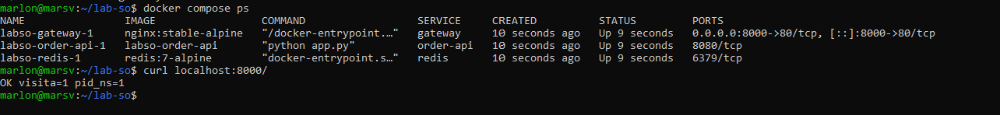
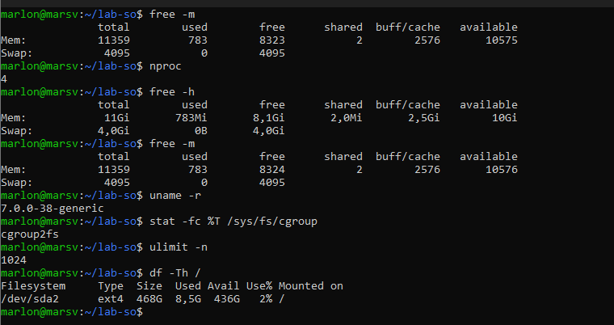

    Se verificó el entorno en Ubuntu Server nativo (4 núcleos, 11359 MiB de RAM, cgroup2fs, ulimit -n en 1024 y disco ext4) y se comprobó el funcionamiento de los tres contenedores (gateway, order-api y redis) respondiendo OK visita=N pid_ns=1.

### Práctica 2 — Un proceso, dos identidades (namespaces y cgroups)
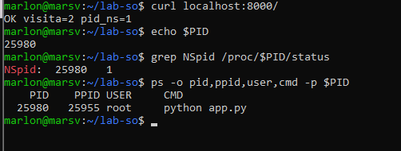

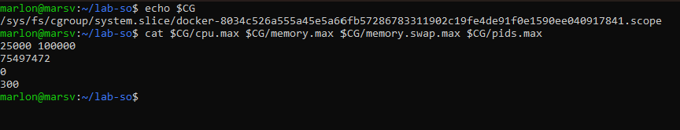

    Se comprobó que order-api es PID 1 dentro del contenedor y tiene otro PID en el host (NSpid), que sus namespaces pid, net y mnt son distintos a los de la terminal del host, y que sus límites están aplicados en cgroups v2 (cpu.max, memory.max, memory.swap.max y pids.max).

### Práctica 3 — CPU limitada (throttling)
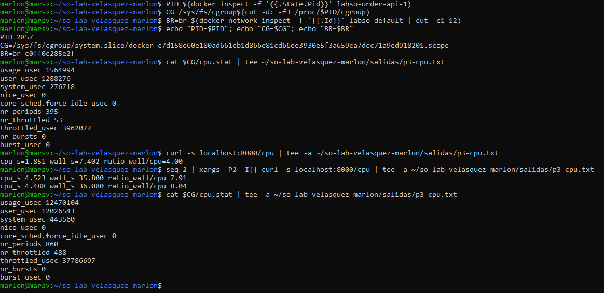

    Predicción: ratio_wall/cpu cercano a 4 con 1 petición y cercano a 8 con 2 peticiones. Medido: 4.00 con 1 petición y 7.91 / 8.04 con 2 peticiones; nr_throttled subió de 53 a 488 (+435). Coincide porque la cuota cpu.max de 25000 100000 (0,25 núcleos) obliga al kernel a pausar la API 75 ms de cada 100 ms.

### Práctica 4 — Memoria y OOM Killer
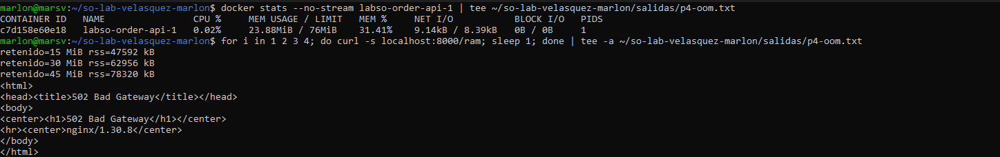
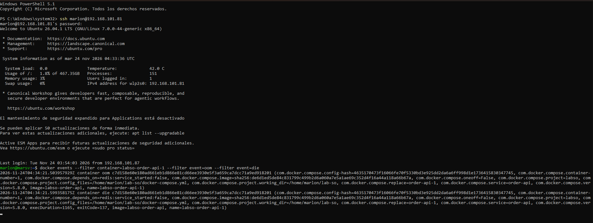
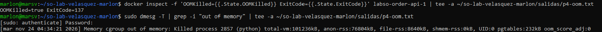

    Predicción: sobrevive 3 llamadas a /ram y muere en la 4.ª con exit code 137. Medido: sobrevivió las llamadas 1, 2 y 3 (15, 30 y 45 MiB) y murió en la 4.ª con 502 Bad Gateway, OOMKilled=true, ExitCode=137 y Memory cgroup out of memory en dmesg. Coincide exacto al calibrar mem_limit y memswap_limit en 76m.

### Práctica 5 — Descriptores de archivo y sockets
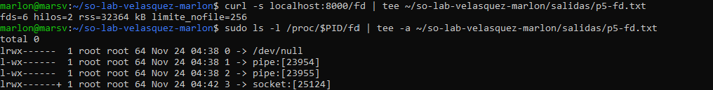
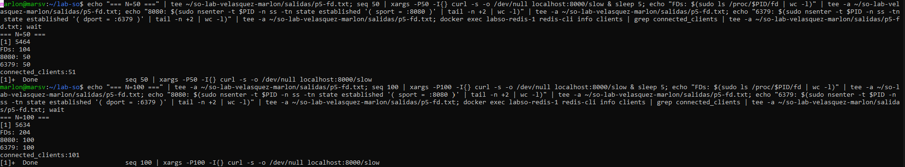
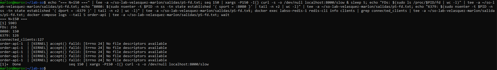

    Predicción: 105 FDs con N=50, 205 FDs con N=100 y tope de 256 FDs (125 simultáneas) con N=150. Medido: 104 FDs (N=50), 204 FDs (N=100) y tope exacto en 256 FDs con 126 conexiones a Redis y error [Errno 24] No file descriptors available en N=150. Coincide con 1 FD de diferencia porque en reposo real había 4 FDs base en vez de 5.

### Práctica 6 — Señales: apagado amable vs. forzado
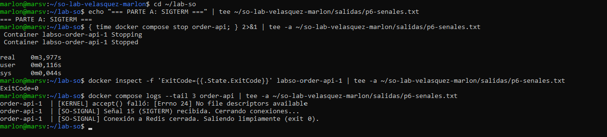

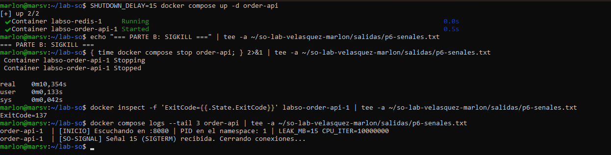
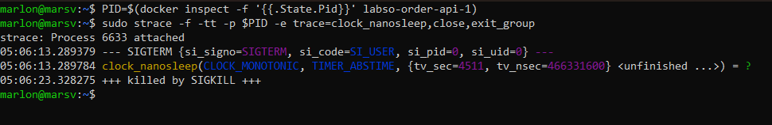

    Predicción: con SIGTERM tarda ≈ 3 s y ExitCode=0; con SIGKILL (SHUTDOWN_DELAY=15) tarda ≈ 10 s y ExitCode=137. Medido: 3.977 s y ExitCode=0 con SIGTERM (exit_group(0) en strace); 10.354 s y ExitCode=137 con SIGKILL (killed by SIGKILL en strace). Coincide porque al superar el límite de 10 s de docker stop, el kernel termina el proceso inmediatamente.

## 5. Diagrama de red

## 6. Resultados
- [Tabla 7: predicción vs. realidad](fase2/tabla7-comparacion.md)
- [Video](fase2/video.md)
- [Cuestionario de la Fase 1](fase1/cuestionario.md)
