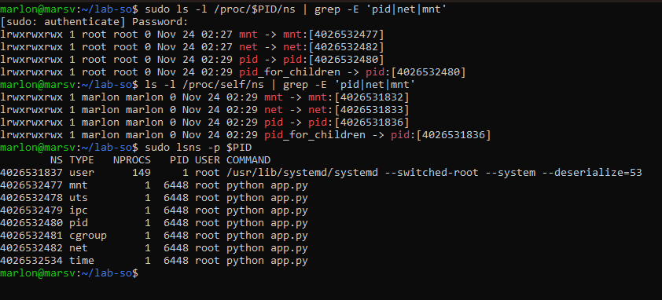
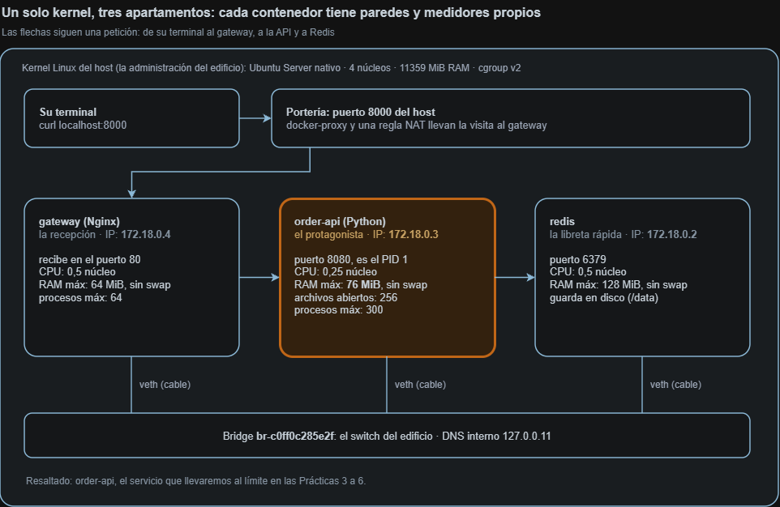

# Laboratorio SO — Kernel Linux detrás de los contenedores
Universidad Tecnológica de Pereira · Tecnología en Desarrollo de Software

## 1. Datos
* Nombre: Marlon Velasquez
* Código: 1117511000
* Usuario de GitHub: mvelasquezumana-dot

## 2. Mi entorno (Tabla 1)
| Dato | Hardware físico | Lo que ve Linux / WSL2 |
|---|---|---|
| Núcleos | 4 | 4 (`nproc`) |
| RAM | 12 GiB aprox. | 11359 MiB (`11Gi` en `free -h`) |
| Versión de cgroups | cgroup v2 | `cgroup2fs` (`stat -fc %T /sys/fs/cgroup`) |

## 3. Cómo instalar y ejecutar (manual de usuario)
1. Requisitos: Ubuntu Server nativo (4 núcleos, 11359 MiB RAM) con `curl`, `unzip`, `strace`, `iproute2` y `apache2-utils`.
2. Instalación de Docker: Docker Engine instalado en Ubuntu con `Cgroup Driver: systemd` y `Cgroup Version: 2`.
3. Levantar el laboratorio:

        cd lab
        docker compose up -d --build
        curl localhost:8000/

4. Repetir las pruebas: en cada sesión nueva de terminal, definir las variables `PID`, `CG` y `BR`, y ejecutar `python3 calculos.py --medir` o los comandos de cada práctica.

## 4. Evidencias por práctica (manual técnico)

### Práctica 1 — Conocer su máquina

    Se verificó el entorno en Ubuntu Server nativo (4 núcleos, 11359 MiB de RAM, cgroup2fs, ulimit -n en 1024 y disco ext4) y se comprobó el funcionamiento de los tres contenedores (gateway, order-api y redis) respondiendo OK visita=N pid_ns=1.

### Práctica 2 — Un proceso, dos identidades (namespaces y cgroups)

    Se comprobó que order-api es PID 1 dentro del contenedor y tiene otro PID en el host (NSpid), que sus namespaces pid, net y mnt son distintos a los de la terminal del host, y que sus límites están aplicados en cgroups v2 (cpu.max, memory.max, memory.swap.max y pids.max).

## 5. Diagrama de red

## 6. Resultados
- [Tabla 7: predicción vs. realidad](fase2/tabla7-comparacion.md)
- [Video](fase2/video.md)
- [Cuestionario de la Fase 1](fase1/cuestionario.md)
